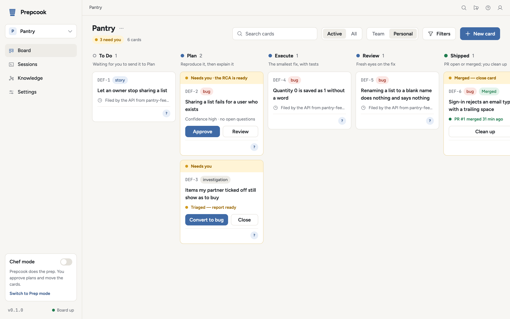
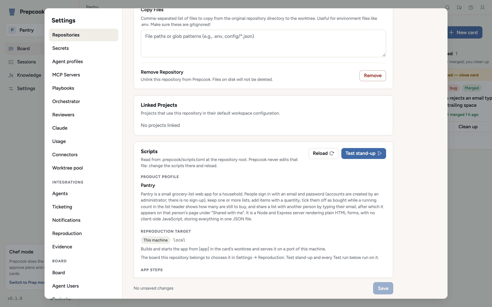
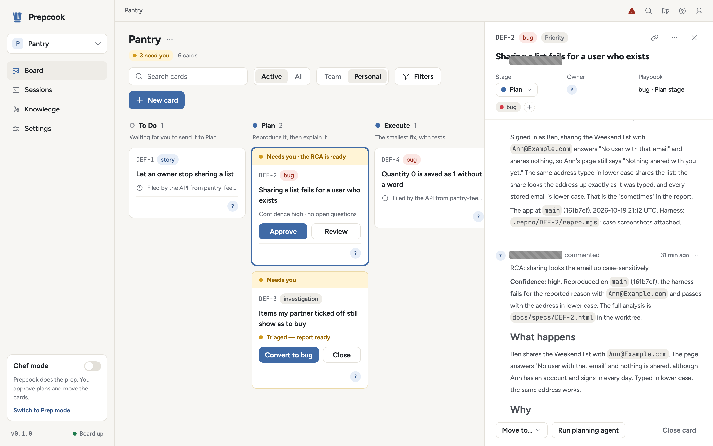
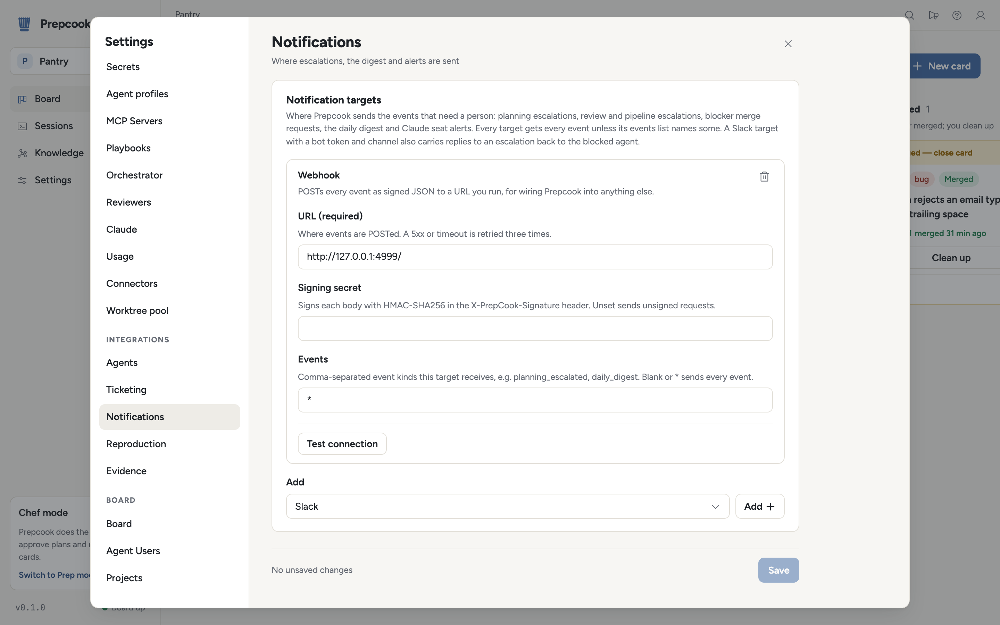

<p align="center">
  <picture>
    <source media="(prefers-color-scheme: dark)" srcset="assets/brand/prepcook-logo-dark.svg">
    
  </picture>
</p>

A prep cook does the prep so the chef can cook. Prepcook does the prep on a
bug — reproduces it, explains it, fixes it, reviews the fix, opens the pull
request — and the engineer who owns the ticket signs off. Each ticket is a card
on a local board, each stage of the card is worked by a coding agent in its own
git worktree, and when a person takes the ticket over, Prepcook steps aside.

<p align="center">
  <picture>
    <source media="(prefers-color-scheme: dark)" srcset="docs/images/board-dark.png">
    
  </picture>
</p>

## What it does

A card moves through five stages, left to right across the board.

**Plan.** Prepcook stands the app up in the card's worktree and an agent
reproduces the bug first, with a harness that fails for the reported reason.
Only then does it write the root-cause analysis (RCA): what happens, why, and
how sure it is. A person approves it, asks for changes, or sends it back.

**Execute.** A new session makes the smallest fix for the mechanism the RCA
isolated and keeps at it until the reproduction passes, adding regression
tests. It commits on a branch rebased onto the target branch and does not push.

**Review.** A separate agent reviews the change in a fresh worktree, with the
diff, the code around it and the reproduction, and none of the planning
context. When it asks for changes, its findings go back to the implementing
agent to fix or rebut, for up to three rounds.

**Push MR.** Prepcook pushes the branch and opens the pull request (GitHub) or
merge request (GitLab), then feeds review comments on it back to the
implementing agent.

**Clean up.** Prepcook runs the repository's clean-up script, archives the
card's worktrees and closes the ticket. Every approved RCA stays in a knowledge
store, linked into a graph of root causes, so a cause that keeps coming back
becomes visible and opens a pattern review of its own.

Prepcook runs in one of two modes. In **Chef mode** it works your tickets and
you move the cards and approve each plan. In **Prep mode** it works on its
own: new tickets are picked up as they arrive, cards move themselves, and plans
are approved from the ticket or through the API.

Not every card is a fix. An **investigation** card, filed through
`POST /api/cards` by a support tool or opened from an incident, runs Plan
exactly as a bug does, then posts a triage report (what happens, where, why,
scope, workaround, confidence) and stops in **Triaged**; an engineer who wants
it fixed converts it to a bug, and the RCA and harness become the plan.
[Tammy](https://github.com/nwisehart/tammy) is the Slack agent built on this:
she answers customers from your product's docs, files an investigation when
something looks broken, and explains the triage report back in plain English.

## Quickstart

This takes a bug from report to pull request on Pantry, a small demo app, with
no tracker: the card is the only record. You need macOS or Linux with Docker
(and Compose), Node 20 or later, git, Claude Code installed and signed in
(`claude` on your `PATH`), and the GitHub CLI signed in (`gh auth login`) for
the pull request at the end.

Your own steps take about 20 minutes. The agents' working time comes on top,
most of it in Plan; expect 30 to 60 minutes end to end.

### 1. Install and start Prepcook (about 10 minutes)

Download the tarball for your platform from the
[releases page](https://github.com/nwisehart/prepcook/releases)
(`prepcook-<version>-<target>.tar.gz`, with `SHA256SUMS` beside it), unpack it and
put `prepcook` and `prepcook-mcp` on your `PATH`:

```sh
tar -xzf prepcook-<version>-macos-arm64.tar.gz
cp prepcook-<version>-macos-arm64/prepcook prepcook-<version>-macos-arm64/prepcook-mcp ~/.local/bin/
prepcook up
```

`prepcook up` writes the board's Docker Compose file and a generated `.env`
into the app data directory, starts the board (the first time, Docker pulls
several hundred megabytes of images, the step most likely to blow the budget),
then starts the Prepcook server and opens the UI. There is nothing to sign in
to: the server signs each request to the board with the board's secret, kept
in that `.env`, so keep the file private. `prepcook status` says what is
running, `prepcook down` stops the board and keeps its data.
[docs/developing.md](docs/developing.md#build-run-and-test) covers building from
a checkout instead, and
[crates/remote/README.md](crates/remote/README.md) running the board elsewhere.

### 2. Add the demo repository (about 5 minutes)

Fork [github.com/nwisehart/prepcook-demo](https://github.com/nwisehart/prepcook-demo)
and clone your fork, so that `origin` is the fork:

```sh
git clone https://github.com/<you>/prepcook-demo.git ~/code/prepcook-demo
```

In Prepcook, **Settings → Repositories → Add Repository** and pick the clone.
The **Scripts** card shows what Prepcook read from the repository's
`.prepcook/scripts.toml`: how to set Pantry up, start it, tell it is ready,
seed it and test it ([docs/scripts.md](docs/scripts.md)).

Click **Test stand-up**. Prepcook runs setup, start, the ready check and the
seed in your clone, on a port from 4200–4299, then stops the app. Success is
the outcome `ok` with every step at exit code 0, in about a minute; anything
else names the failing step and shows its output.

<p align="center">
  <picture>
    <source media="(prefers-color-scheme: dark)" srcset="docs/images/quickstart-stand-up-dark.png">
    
  </picture>
</p>

### 3. Plan: reproduce and explain (about 5 minutes, then 10 to 20 waiting)

1. **Settings → Projects → Add Project**, named `Pantry`.
2. **Settings → Orchestrator**: switch on **Enable automatic agent launches**,
   add `Pantry` under **Automated projects** and tick the `prepcook-demo`
   repository. Leave autonomy off (Chef mode). Save.

Open the Pantry board and click **New Issue**. Copy the first line of the
demo's [BUG.md](https://github.com/nwisehart/prepcook-demo/blob/main/BUG.md)
(without the `#`) into the title and the rest into the description, add the
`bug` tag (it picks the playbook the card takes), and make yourself,
`owner@localhost`, the assignee: Prepcook only works cards assigned to it.
Create it and drag it from **To Do** to **Plan**.

Within one poll (15 seconds) Prepcook makes a git worktree for the card, stands
Pantry up there and starts a Claude Code session. The agent reproduces the bug
first, with a Playwright harness that shares the Weekend list with
`Ann@Example.com` and fails for the reported reason, and posts it as a
`REPRODUCTION:` comment. Only then does it look for the cause and write the
RCA, with its confidence and open questions on the card
([docs/reproduce-first.md](docs/reproduce-first.md)).

<p align="center">
  <picture>
    <source media="(prefers-color-scheme: dark)" srcset="docs/images/card-rca-dark.png">
    
  </picture>
</p>

When the RCA is ready, the card shows **Review plan**, which opens it in
Lavish, a review page with **Approve** and **Request changes**; commenting
`APPROVE` on the card works too. Once approved at high confidence, the card
moves to **Execute** by itself; at lower confidence it stays in Plan and says
why ([docs/approvals.md](docs/approvals.md)).

### 4. Execute, Review, Push MR, Clean up (about 5 minutes, then 15 to 30 waiting)

**Execute.** A new session in the same worktree runs the harness to watch it
fail, makes the smallest change, adds regression tests and commits on a branch
rebased onto `main`. When it has finished, comment `VERIFY:` on the card to
have Prepcook stand the branch up fresh and run `npm test`, the check it makes
before every merge.

**Review.** Drag the card to **Review**. A new agent reviews the change in a
fresh worktree and posts `REVIEW: APPROVE` or `REVIEW: REQUEST CHANGES`; a
request for changes goes back to the implementing agent as a fix round
([docs/review.md](docs/review.md)).

**Push MR.** After `REVIEW: APPROVE`, drag the card to **Push MR**. Prepcook
pushes the branch to your fork and opens a pull request there, its first
comment the reproduction. Merge it on GitHub; within a few minutes the card
moves to **Close**.

**Clean up.** Drag the card to **Clean up**. Prepcook archives the card's
worktrees; the approved RCA stays under the board's **Knowledge** menu.

[docs/method.md](docs/method.md) describes the whole method, Prep mode
included.

## Integrations

Each area is configured under **Settings → Integrations**, rendered from what
each provider says about itself, with a **Test connection** button per
provider. Every setting is in [docs/configuration.md](docs/configuration.md).

| Area | Providers |
| --- | --- |
| Ticketing | Jira and GitHub Issues (tickets mode); PagerDuty incidents (incidents mode, [docs/incidents.md](docs/incidents.md)) |
| Notifications | Slack, signed webhook, Discord, Microsoft Teams ([docs/notifications.md](docs/notifications.md)) |
| Evidence | Sentry, DataSet, Datadog, CloudWatch Logs, log files ([docs/evidence.md](docs/evidence.md)) |
| Reproduction | Local (this machine), remote (a deploy from `[app.remote]`, [docs/scripts.md](docs/scripts.md#remote-targets)) |
| Agents | Claude Code, Amp, Gemini CLI, Codex, OpenCode, Cursor Agent, Qwen Code, GitHub Copilot CLI, Droid, chosen per stage ([docs/configuration.md](docs/configuration.md#agents)) |

<p align="center">
  <picture>
    <source media="(prefers-color-scheme: dark)" srcset="docs/images/settings-integrations-dark.png">
    
  </picture>
</p>

## Working alongside people

Prepcook works tickets that people also work on, read and report on. An
engineer who assigns a ticket to themselves takes it over: what was running
finishes, nothing new starts, and the card is parked for them. It answers on a ticket
only when it is its turn, takes plan decisions only from the people listed as
approvers, and files a follow-up rather than reopening a fix that did not hold
([docs/working-alongside-people.md](docs/working-alongside-people.md)).

## The local toolkit

The same loop also works at your terminal, without the board: Claude Code
skills generated from the orchestrator's own playbooks reproduce, explain, fix,
review and open the pull request on your machine. Their RCAs land in the same
knowledge store; see [toolkit/README.md](toolkit/README.md).

## Documentation

- [docs/method.md](docs/method.md): the method, stage by stage, investigations and the two modes.
- [docs/reproduce-first.md](docs/reproduce-first.md): why the harness comes before the explanation, and what it must assert.
- [docs/approvals.md](docs/approvals.md): every way a plan is approved, changed or sent back.
- [docs/review.md](docs/review.md): the independent review, its verdicts and the pre-merge verify.
- [docs/working-alongside-people.md](docs/working-alongside-people.md): takeovers, comments, the daily update and reopened tickets.
- [docs/playbooks.md](docs/playbooks.md): the prompt each stage starts from, its placeholders, and how to change it.
- [docs/scripts.md](docs/scripts.md): `.prepcook/scripts.toml`, how Prepcook stands an app up locally or remotely.
- [docs/configuration.md](docs/configuration.md): every setting, with the provider tables generated from the code.
- [docs/notifications.md](docs/notifications.md): notification targets and the events they receive.
- [docs/evidence.md](docs/evidence.md): evidence sources, what the agent is told, and `evidence_search`.
- [docs/incidents.md](docs/incidents.md): incidents mode with PagerDuty, and the webhook alternative.
- [docs/rca-graph.md](docs/rca-graph.md): the knowledge store, the root-cause graph and pattern reviews.
- [docs/api.md](docs/api.md): the stable HTTP API: cards, plan decisions, evidence, scripts and app runs.
- [docs/manual-testing.md](docs/manual-testing.md): the end-to-end check by hand before every release.
- [docs/developing.md](docs/developing.md): the architecture, the repository and how to extend Prepcook.
- [docs/images/README.md](docs/images/README.md): the screenshots and how to regenerate them.

## Development

[docs/developing.md](docs/developing.md) covers the architecture, building, testing and adding providers.
[CONTRIBUTING.md](CONTRIBUTING.md) covers how to propose a change.

## License

Apache License 2.0; see [LICENSE](LICENSE). Prepcook is derived from
[vibe-kanban](https://github.com/BloopAI/vibe-kanban) by BloopAI; see
[NOTICE](NOTICE).
