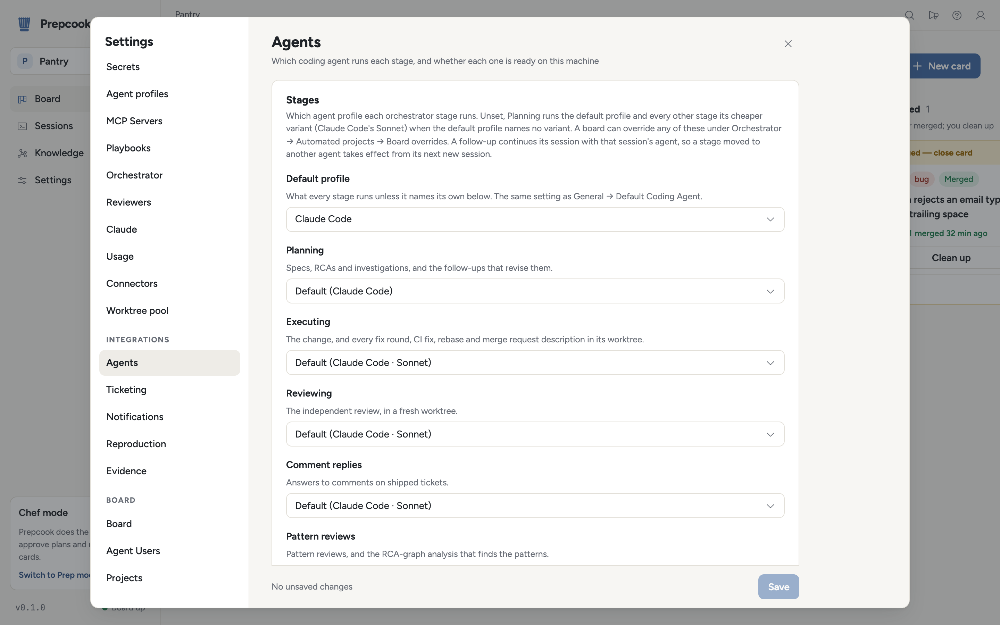
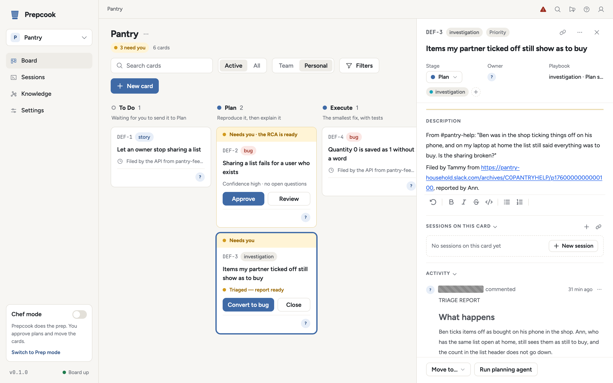

# The method

A prep cook does the prep so the chef can cook. Prepcook does the prep on a
bug — reproduces it, explains it, fixes it, reviews the fix, opens the pull
request — and the engineer who owns the ticket signs off.

Prepcook works a bug the way a careful engineer would, in a fixed order: make it
happen, explain it, fix the mechanism, have someone else check the fix, then
ship it. Each step is a stage, each stage is a column on the board, and a card
moves through them left to right:

```
To Do → Plan → Execute → Review → Shipped │ Clean up
```

Five columns and the Clean up rail. Some of what a card goes through is a state
of the card rather than a column: an investigation that has posted its report is
**triaged** and stays in Plan, and a card in Shipped has a pull request that is
open, merged or closed without merging.

The orchestrator watches the columns from Plan onwards. When a card assigned to
you enters one, it starts that stage's work: an agent session in the card's git
worktree for Plan, Execute and Review, or its own work for Shipped and Clean up.
To Do is where cards wait for a person to start them; a card waits for a person
again when it is triaged, or when its pull request merged or closed. A forward
move goes one column at a time; any card can be moved back, or straight to
Clean up, which takes it only when its pull request merged, when it never had
one, or — for one closed without merging — once a person confirms discarding
the branch and worktree.

A card is in the workflow when it has a work class (`bug`, `investigation`,
`story`, `epic`, `subtask`). A card imported from the tracker gets one from its
issue type. A card made on the board gets one from its tag: tag it `bug` before
moving it to Plan (when a card carries several class tags, the first in that
order wins). A card filed by another service through `POST /api/cards` gets the
one the request names ([api.md](api.md)). The work class picks the playbook each
stage's agent starts from ([playbooks.md](playbooks.md)).

A card is one of three things: a **bug** to fix, an **investigation** to
explain, or a piece of planned work (a **story**, an **epic**, a **sub-task**).

## The stages

| Stage | Produces | Waits on |
| --- | --- | --- |
| **Plan** | A reproduction harness, a `REPRODUCTION:` comment on the card, and a root-cause analysis (RCA) with a verdict: confidence, open questions, a summary. | A person approving the RCA. The card cannot enter Execute until the RCA is approved and its confidence is high. |
| **Execute** | The smallest fix for the mechanism the RCA isolated, its regression tests, and commits rebased onto the target branch. Nothing is pushed. | The fix passing the reproduction and the tests. With autonomy set to Full, the pre-merge verify ([scripts.md](scripts.md#what-each-stage-does)) also has to pass. |
| **Review** | An independent review in a fresh worktree: a verdict and typed findings, recorded on the card ([review.md](review.md)). | `REVIEW: APPROVE`. A `REQUEST CHANGES` goes back to the implementation agent as a fix round. |
| **Shipped** | The pushed branch and the pull request (GitHub) or merge request (GitLab), with the reproduction as its first comment and reviewers picked from blame. | People reviewing and merging it. While it is open their comments are fed back to the implementation agent, and in Prep mode a failing pipeline and a conflict with the target branch go back too. Once everything merged, the tracker ticket moves to `status_mapping.done` and the card waits, under an amber **Merged — close card**, for you to clean it up. |
| **Clean up** | The repository's clean-up scripts run, the card's worktrees archived. | Nothing; it is the last column, folded into a rail beside the board. |

### Shipped

Shipped holds a card from the moment its pull request opens until a person cleans
it up, and what the card shows comes from the pull request, not the column:

| Pull request | Chip on the card | The card | What runs |
| --- | --- | --- | --- |
| None yet | — | Opening the pull request | The push and the pull request. |
| Open | **PR open** | No amber: the agent and the reviewers have it. | Review comments go to the implementation agent; in Prep mode so do a failing pipeline and a conflict. |
| Open, pipeline red | **CI failing** | As open. The chip comes from the Prep mode pipeline watch, which has seen the head pipeline fail and not pass since. | As open. |
| Merged (none still open) | **Merged** | Amber **Merged — close card**, with **Clean up**. Counts in the "need you" pill. | The tracker transition to `status_mapping.done`, once. |
| Closed without merging | **PR closed, not merged** | Amber **PR closed without merging**, with **Clean up**, which first asks "Discard the branch and worktree?". The git hosts offer no reopen through Prepcook; reopen it on the host and the card is back to open. | Nothing; a person decides. |

A card with several pull requests is open while any one is open, merged when
none is open and one merged, and closed only when every one closed unmerged.

Clean up refuses a card whose pull request is still open, with the reason, on
the board and on the server alike; a closed, unmerged one goes in only with the
discard confirmed (`discard_confirmed_at` on the card). A card that never had a
pull request — an investigation, a story closed without code — goes straight
in. A ticket a person closes in the tracker retires its card the same way: an
open pull request keeps the card in Shipped and is announced on the board's
channel, and a closed one counts as confirmed.

Plan comes first because a fix without a reproduction is a guess
([reproduce-first.md](reproduce-first.md)). Every approved bug RCA is filed in
the knowledge store and linked into the root-cause graph
([rca-graph.md](rca-graph.md)).

### Which agent runs which stage

<p align="center">
  <picture>
    <source media="(prefers-color-scheme: dark)" srcset="images/settings-agents-dark.png">
    
  </picture>
</p>

**Settings → Agents** names the profile each stage runs, globally or per board
([configuration.md](configuration.md#agents)). Left unset, Plan runs the
default coding agent profile and every other stage runs that agent's cheaper
variant (Claude Code's Sonnet) when the default profile names no variant. Plan
is where the design judgment is, so it gets the full model. The rest is where
the sessions pile up: Execute carries out a plan a person already approved, in
the change and then every fix round, CI fix, rebase and merge-request
description; Review is a fresh full-diff session every round; comment replies
and the RCA graph's analysis run often and only read. Together they spend most
of a subscription seat's session budget. A follow-up continues its own
session, so it can change variant but never agent.

### Cards from outside the team

A card's text is not always the team's. A card filed through `POST /api/cards`
(by Tammy, an incident tool or any other service, which is to say any card with
an `origin`) and a GitHub issue opened by someone who is not an owner, member or
collaborator of the repository (recorded on the card at intake) count as filed
from outside the team; a ticket from the team's own Jira, and a card made on the
board, do not. Such a card plans under `agents.external` instead of the planning
profile ([configuration.md](configuration.md#agents)). Unset, that is the
planning profile's agent with its guarded variant: for Claude Code, `GUARDED`,
which takes away the `WebFetch` and `WebSearch` tools and never skips
permissions; an agent that ships no guarded variant plans the card under the
planning profile unchanged. The card panel's Origin line then says "Planned
under the guarded profile". Executing and Reviewing run their usual profiles:
an investigation never executes until a person converts it, and a bug or story
executes from a plan that was approved. In Chef mode a person approves it; in
Prep mode a plan that clears the bar approves itself, so a bug filed from
outside the team can reach Executing with no one having read it. A service that
files reports from outside the team should file them as investigations, as Tammy
does: an investigation always waits for a person. The guarded profile narrows the agent's own
tools; it does not confine the shell the agent runs commands in.

## Investigations

An investigation is a reported problem Prepcook reproduces and explains but
does not fix — typically filed by a support agent from a customer conversation,
which then translates the answer for the customer.

<p align="center">
  <picture>
    <source media="(prefers-color-scheme: dark)" srcset="images/card-triaged-dark.png">
    
  </picture>
</p>

- **Plan** runs exactly as for a bug, from the `investigation:planning`
  playbook: the app stood up, the harness first, the `REPRODUCTION:` comment,
  then the RCA and its verdict. The agent then posts a `TRIAGE REPORT` comment
  in a fixed shape — `## What happens`, `## Where`, `## Why` (from the RCA, one
  paragraph), `## Scope` (who and what is affected, and whether it is
  configuration or a defect, with the evidence), `## Workaround` (or "none
  found") and `## Confidence` (high, medium or low, with one line why) — and
  stops. It does not plan a fix or write a spec.
- **Triaged.** Once that comment is on the card, the orchestrator records the
  report on the card — which is what makes it triaged — sends
  `investigation_completed` to the board's notification targets
  ([notifications.md](notifications.md)), and copies the report onto the
  tracker ticket (moving it to `status_mapping.triaged` when that is set; on an
  incident, as a note, resolving it only with `incidents.resolve_on_triage`).
  The card stays in **Plan** under an amber **Needs you** header reading
  "Triaged — report ready", with **Convert to bug** and **Close** on it, and
  counts in the "need you" pill. There is no approval gate, in Chef mode or
  Prep mode, and nothing more runs for it.
- **Close.** An investigation that needs no fix is closed: **Close** moves it
  to Clean up, which takes it because it never had a pull request.
- **Convert.** An engineer who wants it fixed converts the card — the class
  label's menu on the card (**Convert to bug**), or
  `POST /api/cards/{id}/convert` ([api.md](api.md#convert-a-card)). The tag and
  class change; every comment, attachment, the RCA and the harness stay. When
  the RCA is at high confidence and the harness is still on disk, they are the
  plan: the conversion is recorded as its approval and the card goes straight
  to Execute, where `bug:executing` starts in the same worktree. Otherwise it
  goes back to Plan and is planned as a bug. Converting to a story always
  plans again.

An investigation never executes: the Executing gate refuses it ("investigation
cards do not execute; convert to a bug first"), and so does the board.

A board whose team added a column named **Triaged** keeps using it: a triaged
investigation moves there, with the same amber header and actions, instead of
staying in Plan. The transition rules leave that column alone.

Stories, epics and sub-tasks take the same columns. In Plan a story gets an
implementation spec, an epic a plan with a breakdown into sub-tasks, and a
sub-task a spec for its slice; the card cannot advance while the spec has open
questions. In Execute an epic creates its sub-tasks instead of code. Nothing but
a bug, and an investigation in Plan, stands the app up.

## Boards made before Shipped

A project made before the five columns keeps its own — To Do, Plan, Triaged,
Execute, Review, Push MR, Close, Clean up — and keeps working: nothing is
migrated. Push MR is read as Shipped (the pull request is opened and watched
there, with the same chips); a merge moves the card on to Close as it always
did, and fires the tracker's `done` transition as it lands; Close shows the
same amber **Merged — close card**; and the Triaged column goes on receiving
triaged investigations. The `needs-column` tag is no longer applied; one left
on a card is an ordinary tag you can delete.

To move such a board to the five columns, open the board's project menu
(**…**), **Edit project settings**, and under **Project Statuses**:

1. Empty **Close**: drag each merged card to **Clean up** (or back to
   **Push MR**, where it shows **Merged — close card** until you do).
2. Rename **Push MR** to `Shipped` with **Edit name**.
3. **Delete status** on **Close**, and on **Triaged** if you no longer want
   it; a column with cards in it offers **Move issues first** — move triaged
   investigations to **Plan**, where they keep their triaged state.
4. Save. The next poll reads the new names; no card needs to move.

A board whose fifth column is named Done keeps working as it is: Done is read
as Shipped. Renaming it to `Shipped` with **Edit name** is all it takes to
match a new board.

A board can keep any of the older columns it likes: Close and Triaged work
whenever they exist, and Shipped, Done and Push MR are the same stage under
three names.

## The two modes

The same stages run in two modes. The mode is **Settings → Orchestrator →
Autonomy mode**, global or per board.

**Chef mode** (autonomy off, the default). Prepcook works your tickets and you move
them. You import tickets from the tracker or make cards on the board, drag them
between columns, and approve plans in Lavish, the review page each plan opens
in (the **Review plan** button on the card). Stories and epics get a spec or a
breakdown the way bugs get an RCA. A review's `REQUEST CHANGES` still starts a
fix round on its own; advancing an approved card is yours.

**Prep mode** (autonomy on). Prepcook works on its own, on the machine meant to
run unattended. Tickets the tracker's pickup filters select are imported as
they arrive. Cards move themselves: a plan that clears the bar (an RCA at high
confidence, a spec with no open questions) approves itself and goes to Execute;
one below the bar is escalated to Slack and waits in Plan for a person, whose
decision comes from the tracker ticket, the card or the approvals API
([approvals.md](approvals.md)). A finished, verified fix goes to Review, and an
approved review goes to Shipped.

Either way a person merges. When an engineer takes a ticket over, Prepcook steps
aside ([working-alongside-people.md](working-alongside-people.md)).

## Without a tracker

A tracker is optional. With none configured, every card is made on the board
and the card is the only record: nothing is imported, nothing is posted to a
ticket, and no sweep that reads a ticket's status runs. Every stage still runs,
plan decisions come from Lavish, the card or the API, and the pull request is
still opened. A card made on the board while a tracker is configured is treated
the same way. The [quickstart](../README.md#quickstart) uses this path.

## Tickets or incidents

Where cards come from is the ticketing mode (**Settings → Integrations →
Ticketing**, `ticketing.mode`).

**Tickets** (the default). The source is a ticket tracker — Jira, or GitHub
Issues through the `gh` CLI — and each ticket's type picks its work class.
Stages show on the ticket as the statuses (on GitHub, the labels) that
`status_mapping` names.

**Incidents.** The source is an incident tool — PagerDuty. Every open incident
on the configured services becomes an **investigation** card in Plan: Prepcook
acknowledges it, reproduces and explains the problem, and adds the
triage report to the incident as a note. It never pages anyone and resolves
the incident only when configured to ([incidents.md](incidents.md)).

The two modes above (Chef and Prep) apply in either.

## More

- [scripts.md](scripts.md): how Prepcook installs, starts, seeds and tests the app.
- [playbooks.md](playbooks.md): the prompt each stage's agent starts from.
- [approvals.md](approvals.md): every way a plan is decided.
- [incidents.md](incidents.md): Prepcook as a first responder on PagerDuty
  incidents.
- [api.md](api.md): filing, reading and converting cards, and the other HTTP
  endpoints scripts use.
- [configuration.md](configuration.md): every setting and its default.
- [toolkit/README.md](../toolkit/README.md): the same method at your terminal,
  without the board.
