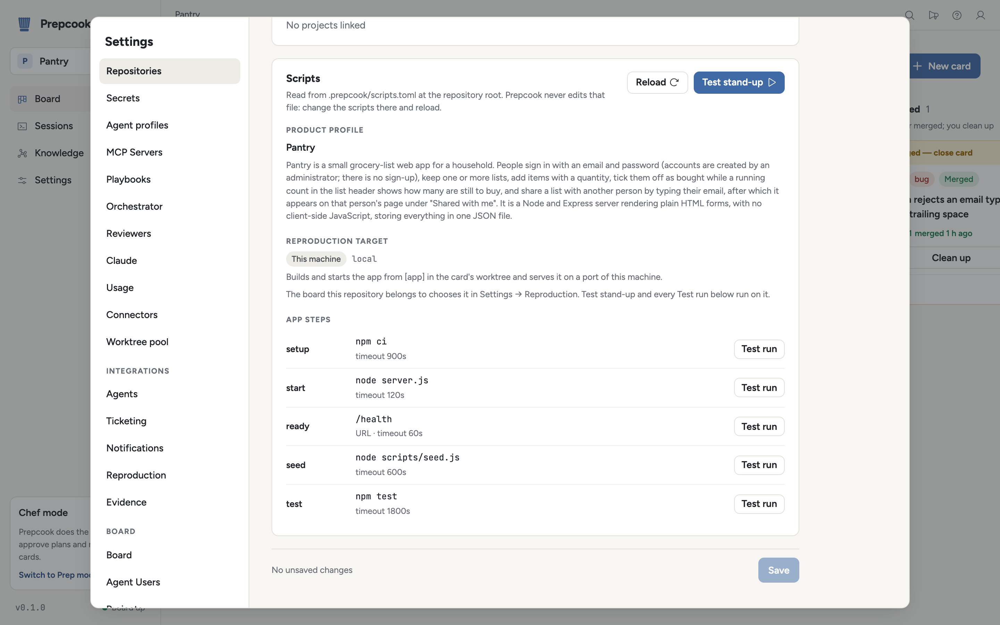

# `.prepcook/scripts.toml`

Every repository Prepcook works on describes how to install, build, start, seed and
test itself in `.prepcook/scripts.toml` at its root. Prepcook runs those scripts itself,
in the card's worktree, on a port it allocates, and hands the app's address and
test login to the agent through environment variables.

That is the `local` reproduction target. A board can instead use the `remote`
target, which runs `[app.remote]` to deploy the branch to a preview
environment, a dev tenant or a staging slot and works against the URL the
deploy reports; see [Remote targets](#remote-targets).

A repository without the file still works: its cards run without an app, and
the pre-merge verification step is skipped.

## Schema

All commands run through the user's shell (`$SHELL -c`, falling back to `sh`)
with the worktree root as the working directory. Unknown keys are an error, and
the error names the key.

```toml
[app]
setup = "pnpm install"        # optional; install dependencies; exit 0 = ready
build = "pnpm build"          # optional
start = "pnpm start"          # required; listen on $PREPCOOK_PORT and stay in the foreground
ready = { url = "/health", timeout_secs = 300 }
#   or  { command = "curl -sf $PREPCOOK_APP_URL/health", timeout_secs = 300 }
#   optional; `url` is a path appended to $PREPCOOK_APP_URL and passes on any 2xx,
#   `command` passes when it exits 0. Exactly one of the two.
seed = "node scripts/seed.js" # optional; load test data, write KEY=VALUE lines to $PREPCOOK_ENV_OUT
test = "pnpm test"            # optional; the exit code is the verdict
stop = "pnpm stop"            # optional; runs before Prepcook kills the start process group

[app.remote]                  # optional; the remote target (see "Remote targets")
start = "./scripts/deploy-preview.sh"   # required; deploys, reports the URL, exits
ready = { url = "/health", timeout_secs = 600 }   # optional; against the reported URL
seed = "node scripts/seed-remote.mjs"   # optional; [app] seed is not used remotely
test = "pnpm test:e2e"        # optional; [app] test is not used remotely
stop = "./scripts/destroy-preview.sh"   # optional; destroys what start deployed
restart = "./scripts/deploy-preview.sh --update"  # optional; default is stop, then start
max_parallel = 1              # remote apps up at once (default 1)

[app.remote.timeouts]         # seconds; these are the defaults
start = 1800
seed = 600
test = 1800
stop = 900

[app.timeouts]                # seconds; these are the defaults
setup = 900
build = 1200
start = 120                   # time for `start` to begin listening on $PREPCOOK_PORT
seed = 600
test = 1800
stop = 120

[workspace]                   # optional workspace lifecycle hooks
setup = "..."                 # before the first agent turn; defaults to app.setup
cleanup = "..."               # after an agent turn that changed files
archive = "..."               # when the workspace is archived

[secrets]
requires = ["TEST_USER_PASSWORD"]   # names only, never values; checked before any run

[profile]                     # product profile for the playbooks (docs/playbooks.md)
name = "Example App"
summary = "One paragraph on what the app is."
areas = ["Sign-in", "Dashboard"]
error_patterns = ["SeedDataMissing"]
evidence_tools = "Logs older than a day are in the ops archive."  # optional appendix

[[profile.evidence]]          # optional, repeatable: log files the app writes
kind = "log_files"            # the only kind a manifest may name
label = "App log"             # optional
paths = ["logs/app.log"]      # files or globs, relative to the worktree
notes = "One JSON line per request."  # optional
```

`[profile] evidence_tools` is an appendix, not where an agent learns where the
logs are: each evidence source, including the `[[profile.evidence]]` log files, gets
its own paragraph in `{{product.evidence_tools}}`, and `evidence_tools` is
appended after them for whatever they do not say ([evidence.md](evidence.md),
[playbooks.md](playbooks.md#the-product-profile)).

A complete manifest for a small web app is in
[examples/scripts.toml](examples/scripts.toml).

### Stand-up

A stand-up runs `setup`, `build`, `start`, the ready check and `seed`, in that
order, stopping at the first failure:

1. `setup` and `build` run to completion within their timeouts.
2. `start` is spawned in its own process group, with its output captured.
3. Prepcook waits for something to accept connections on `$PREPCOOK_PORT`, for up to
   `timeouts.start` seconds. If `start` exits first, the outcome is
   `start-failed`; if nothing listens in time, `not-ready`.
4. The ready check is polled every half second for up to
   `ready.timeout_secs`, counted from when the port started listening.
   Without a ready check, a listening port is ready.
5. `seed` runs; afterwards Prepcook reads `$PREPCOOK_ENV_OUT`.

Teardown runs `stop` (bounded by `timeouts.stop`), then signals the whole start
process group (SIGINT, SIGTERM, SIGKILL, two seconds apart) and frees the port.
Teardown always completes, whether or not `stop` succeeds.

At most `app_runs.max_parallel` local apps (default 2) are up at once. A stand-up
asked for while every slot is taken is refused as `busy` immediately; the
orchestrator leaves the card where it is and asks again on its next tick.

### Outcomes

| Outcome | Whose problem |
| --- | --- |
| `ok` | — |
| `setup-failed`, `build-failed`, `start-failed`, `not-ready`, `seed-failed`, `test-failed` | the branch |
| `manifest-missing`, `manifest-invalid`, `target-unconfigured`, `secret-missing`, `port-unavailable`, `error` | the setup |
| `busy` | nobody; retried |

`target-unconfigured` means the board reproduces against the remote target and
the manifest has no `[app.remote]`.

## Environment

Every script receives the Prepcook process's own environment plus:

| Variable | Value |
| --- | --- |
| `PREPCOOK_PORT`, `PORT` | the port allocated for this run |
| `PREPCOOK_APP_URL` | `http://127.0.0.1:<port>` |
| `PREPCOOK_WORKTREE` | absolute path of the worktree |
| `PREPCOOK_TICKET_KEY` | the card's key (e.g. `BUG-1234`); may be empty |
| `PREPCOOK_RUN_ID` | the run's id (a UUID) |
| `PREPCOOK_ENV_OUT` | a file the seed script appends `KEY=VALUE` lines to |
| `PREPCOOK_CHANGED_FILES` | `test` only: newline-separated paths, relative to the worktree, from `git diff --name-only <target>...HEAD` |
| `PREPCOOK_SECRET_<NAME>` and `<NAME>` | every secret in the secrets store |

Ports come from `app_runs.port_range` in the Prepcook config (default
`4200-4299`). A port is handed out only if no other run holds it and nothing is
already bound to it.

### What the seed hands on

After `seed`, Prepcook reads `$PREPCOOK_ENV_OUT` (blank lines and `#` comments are
skipped) and adds each variable to the environment of the agent session that
works against the app. Name them so the agent can find them, for example
`PREPCOOK_TEST_USER_EMAIL` and `PREPCOOK_TEST_USER_PASSWORD`. The value of any variable
whose name contains `PASSWORD`, `SECRET`, `TOKEN` or `KEY` is registered for
redaction (see below).

### What an agent session receives

`PREPCOOK_APP_URL`, `PREPCOOK_PORT`, `PREPCOOK_WORKTREE`, `PREPCOOK_RUN_ID`, every variable the
seed wrote, and every secret (`PREPCOOK_SECRET_<NAME>` and `<NAME>`).

## What each stage does

- **Planning** (bug cards): before the agent starts, Prepcook creates the worktree
  and stands up the reported version of the app in it. The agent's Playwright
  harness runs against `PREPCOOK_APP_URL`. If the reported version does not stand
  up (a branch-side outcome), the planning session is not started; the card
  gets a comment with the failing step's output and waits for a person.
- **Executing** (bug cards): the fix branch's worktree is stood up the same way
  before the agent starts. If it does not stand up, the session starts anyway
  with the failure in its prompt — making the app stand up is then part of the
  work.
- Either stage, when the setup is at fault (no manifest on the branch, a
  missing secret, no free port): the failure is escalated to Slack and as a
  desktop notification, and the session starts without an app.
- The app is torn down when the agent process it was stood up for finishes,
  when the workspace is archived or cleaned up, and when Prepcook shuts down.
- **Pre-merge verification**: a fresh stand-up plus `test` in the
  implementation worktree. It runs automatically only with autonomy set to
  Full (Prep mode): when an Executing turn completes, the card does not
  advance to Review until it passes. A branch-side failure is handed back to
  the executing agent with the failing step's output (up to four rounds); a
  setup-side failure holds the card, is escalated, and is retried after 15
  minutes. With autonomy off, nothing runs it on its own and a person moves
  the card. In either mode, a comment on a card in Execute, Review or Shipped
  whose first line is `VERIFY:` runs the same check on demand and posts the
  result on the card and the merge request.
- Story, epic and subtask cards do not stand the app up.

Agents have two MCP tools: `app_status` (the URL, the target kind, the port
for a local app, the seed variable names, the start time, and `health`: whether
the app answers its ready check now) and `app_restart` (stand the app up again
in the same worktree, to test a candidate change; stands one up if none is
running).

The preview's dev server runs `[app] start` with a port from the same range,
on this machine, whichever target the board uses.

## Remote targets

A board whose `reproduction.target` is `remote` (Settings → Reproduction; the
default for every board is `app_runs.default_target`, itself `local` unless
changed) stands its apps up with `[app.remote]` instead of serving them here.
The commands still run on this machine, in the card's worktree; what differs is
that `start` deploys and exits rather than serving in the foreground. Every
stage is the same — the planning and executing sessions get `PREPCOOK_APP_URL`,
the harness and the pre-merge verification run against it, and `app_status` /
`app_restart` work as they do locally.

A remote stand-up runs `[app] setup` (the scripts need the worktree's
dependencies; `[app] build` is skipped, the deploy builds where it deploys),
then `[app.remote] start`, the ready check against the reported URL, and
`[app.remote] seed`. Teardown runs `[app.remote] stop`. A restart runs
`[app.remote] restart` in place when it is set, and otherwise `stop` then a
fresh stand-up. There is no port allocation, and `[app.remote] max_parallel`
(default 1) caps remote apps separately from `app_runs.max_parallel`: a
preview environment per card is expensive.

### The script contract

Every `[app.remote]` command receives the Prepcook process's environment plus:

| Variable | Value |
| --- | --- |
| `PREPCOOK_WORKTREE` | absolute path of the worktree |
| `PREPCOOK_TICKET_KEY` | the card's key (e.g. `BUG-1234`); may be empty |
| `PREPCOOK_RUN_ID` | the run's id (a UUID); unique per stand-up, so it can name the environment |
| `PREPCOOK_BRANCH` | the worktree's checked-out branch; empty on a detached HEAD |
| `PREPCOOK_ENV_OUT` | a file the scripts append `KEY=VALUE` lines to |
| `PREPCOOK_APP_URL` | the reported URL — every command after `start` (and `restart`, which is told what it replaces) |
| `PREPCOOK_TARGET_REF` | what `start` named the deployment, when it did — `stop` and `restart` |
| `PREPCOOK_CHANGED_FILES` | `test` only, as for the local target |
| `PREPCOOK_SECRET_<NAME>` and `<NAME>` | every secret in the secrets store |

`start` must exit 0 once the app is deployed and say where it is:

1. a `PREPCOOK_APP_URL=<url>` line appended to `$PREPCOOK_ENV_OUT`, or failing
   that
2. the last line of its stdout that starts with `http://` or `https://`.

It may also append `PREPCOOK_TARGET_REF=<name>` (an environment name, a
deployment id) for `stop` and `restart` to act on, and any other `KEY=VALUE`
lines, which reach the agent session like the seed's. A `start` that exits
non-zero is `start-failed`; one that exits 0 without a URL breaks the contract
and is an `error` (the setup's problem). Whatever happens, once `start` has
run, teardown runs `stop`, so a failed or abandoned deploy is still destroyed.

A deploy script for a preview-environment CLI, as a sketch:

```sh
#!/bin/sh
# scripts/deploy-preview.sh
set -eu
name="pc-$(printf %s "$PREPCOOK_RUN_ID" | cut -c1-8)"
preview-cli deploy --name "$name" --branch "$PREPCOOK_BRANCH" --wait
echo "PREPCOOK_TARGET_REF=$name" >> "$PREPCOOK_ENV_OUT"
echo "PREPCOOK_APP_URL=$(preview-cli url --name "$name")" >> "$PREPCOOK_ENV_OUT"
```

```sh
#!/bin/sh
# scripts/destroy-preview.sh
exec preview-cli destroy --name "$PREPCOOK_TARGET_REF" --yes
```

A board set to `remote` whose repository has no `[app.remote]` does not crash
or fall back to a local run: its stand-ups stop with `target-unconfigured`,
which is escalated like any other setup problem, and the Scripts panel says so.

## Secrets

Values the scripts need but that must not be committed live in
`~/.config/prepcook/secrets.env` on every platform, as `NAME=VALUE` lines with `#`
comments. The file is written with mode `0600`. `PREPCOOK_SECRETS_FILE` points Prepcook
at a different file, and an environment variable `PREPCOOK_SECRET_<NAME>` overrides
the file's entry.

```sh
prepcook secret set TEST_USER_PASSWORD   # prompts on a terminal; otherwise reads stdin
prepcook secret list                     # names only
prepcook secret unset TEST_USER_PASSWORD
```

The same store is exposed at `GET /api/secrets` (names and the file path, never
values), `PUT /api/secrets/{name}` with `{ "value": "..." }`, and
`DELETE /api/secrets/{name}`.

Every secret value of six characters or more, and every sensitive seed value,
is replaced with `[redacted]` in script logs, card comments, merge request
notes and Slack messages.

A stand-up whose `[secrets] requires` names a secret with no value stops before
any script runs, with the outcome `secret-missing`.

## Trying it from Settings

<p align="center">
  <picture>
    <source media="(prefers-color-scheme: dark)" srcset="images/settings-repositories-dark.png">
    
  </picture>
</p>

- `GET /api/repos/{id}/scripts` — the repository's parsed manifest, or the
  error, plus `required_secrets_missing`.
- `POST /api/repos/{id}/scripts/run` with
  `{ "step": "setup" | "build" | "start" | "ready" | "seed" | "test" | "stop" | "stand-up" }`
  runs in the repository's checkout, on the target the repository's board
  uses, and returns `{ "run_id": ... }`. `start` and `ready` start the app
  without setup, build or seed and tear it down once it is ready (or, for a
  local app with no ready check, once `timeouts.start` passes with the process
  still up). On a remote target `stand-up` deploys, seeds and destroys.
- The manifest response carries `target` (`local` or `remote`) and
  `target_problem`, the reason that target cannot run this manifest, if any.
- `GET /api/script-runs/{id}` — the report once the run finishes;
  `GET /api/script-runs/{id}/raw-logs/ws` streams its output.

## Example: a Node web app

```toml
# .prepcook/scripts.toml
[app]
setup = "pnpm install --frozen-lockfile"
build = "pnpm build"
start = "pnpm start --port $PREPCOOK_PORT"
ready = { url = "/api/health", timeout_secs = 120 }
seed = "node scripts/seed-test-user.mjs"
test = "pnpm test"
stop = "node scripts/close-db.mjs"

[app.timeouts]
setup = 600
build = 900
start = 60

[workspace]
cleanup = "pnpm lint --fix"

[secrets]
requires = ["TEST_USER_PASSWORD", "STRIPE_TEST_KEY"]

[profile]
name = "Acme Billing"
summary = "Customer billing portal: sign in, view invoices, update a card."
areas = ["Sign-in", "Invoices", "Payment methods"]
error_patterns = ["SeedDataMissing", "StripeAuthError"]
```

```js
// scripts/seed-test-user.mjs
import { appendFileSync } from "node:fs";

const email = `test+${process.env.PREPCOOK_RUN_ID}@example.com`;
const password = process.env.TEST_USER_PASSWORD;
await fetch(`${process.env.PREPCOOK_APP_URL}/api/test/users`, {
  method: "POST",
  headers: { "content-type": "application/json" },
  body: JSON.stringify({ email, password }),
}).then((res) => {
  if (!res.ok) throw new Error(`seed failed: ${res.status}`);
});
appendFileSync(
  process.env.PREPCOOK_ENV_OUT,
  `PREPCOOK_TEST_USER_EMAIL=${email}\nPREPCOOK_TEST_USER_PASSWORD=${password}\n`,
);
```
