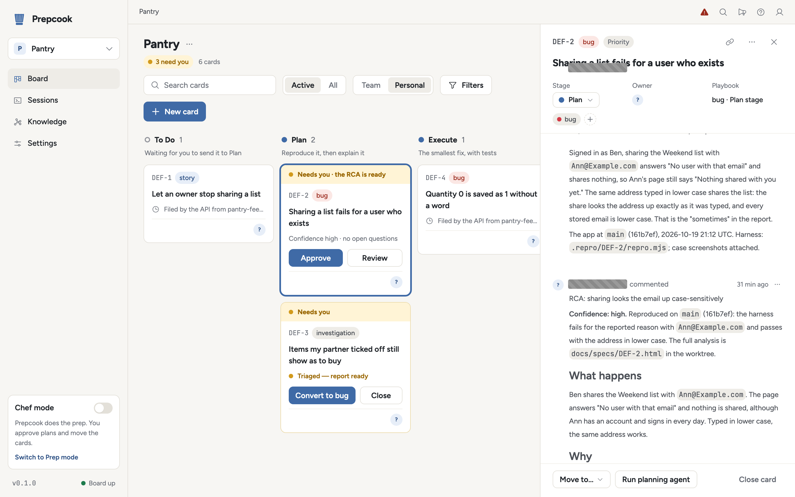

Hand a coding agent a bug report and you will have a fix within minutes: a tidy
diff, an explanation that sounds right, passing tests. What you will not have is
evidence that the code it changed is the code the reporter's request ran
through. So you check. You reread the report, find the path, set up the data,
try it before and after, and somewhere in that hour you notice you are doing the
part the agent skipped, and that it is the bigger part. The fix was never the
slow bit. Knowing it was the right fix was.

Prepcook is my attempt to put that bigger part first. It works a bug in a fixed
order, one column per step on a local board ([the
method](../../docs/method.md)), and the first rule is the one this post is
about: before anyone explains the bug, the bug has to happen on demand.

## What reproduce first means

A bug card's Plan stage does two things, always in this order. Prepcook stands
the app up in the card's git worktree from the repository's own scripts, and the
planning agent writes a harness: a Playwright script, run against that app, that
asserts the behaviour the reporter described. It prints one JSON line per case,
expected against observed, screenshots each case, and exits non-zero when one
fails. On the target branch it has to fail, for the reported reason, or the
ticket is not reproduced.

The agent is told not to read code for the cause until that harness exists. It
sounds fussy. It is the rule that matters most. Code that looks wrong is
everywhere, and an agent that reads first finds something suspicious within a
minute and builds a plausible story around it. Whether that code is on the
reporter's path is a different question, and only running the path answers it.
"I can see the bug in the code" is a reading. A harness that fails on the branch
is a fact.

The moment the harness fails, its result goes on the card as a `REPRODUCTION:`
comment: the JSON lines, the mechanism in one paragraph, the commit the app was
built from and the time. Plan does not end in a fix, and the planning agent is
told not to start one. It ends in an explanation, and the card cannot enter
Execute until that explanation is approved.

A bug that happens "sometimes" is measured as a rate against a healthy control,
and a harness that will not fail has to say which of four reasons explains that,
rather than quietly calling the bug gone ([reproduce
first](../../docs/reproduce-first.md)).

## The analysis is a document someone approves

With the failure in hand, the agent looks for the cause. It confirms the
mechanism by making the harness pass against a candidate change where it can,
and searches the error tracker and logs the board knows about; a source that
shows nothing is recorded as showing nothing. Then it writes the root-cause
analysis.

The RCA has a fixed shape, and each part has a job. The symptom is what the
reporter saw; the reproduction is what was actually run; the root cause is the
mechanism and its evidence; the blast radius is where else the same mistake
could bite. The proposed fix and its regression tests say what Execute will do,
the open questions say what nobody knows yet, and a last section says how to
reproduce the bug on your own machine.

<figure>
  <picture>
    <source media="(prefers-color-scheme: dark)" srcset="../../docs/images/card-rca-dark.png">
    
  </picture>
  <figcaption>The demo app's sharing bug open in Plan: the end of its <code>REPRODUCTION:</code> comment, then the RCA, which finds that sharing looks the address up exactly as typed while every stored address is lower case. Behind it, the card waits on the board under "Needs you · the RCA is ready".</figcaption>
</figure>

At the top sits the verdict: a summary, the open questions, and a confidence of
low, medium or high. Confidence is a claim about evidence, not a feeling: a
harness that would not fail, or rates that would not separate, mean low. Below
high, the RCA names the confirmation it is missing and lists the next steps that
would raise it, the most valuable question first, and it cannot leave Plan.

Then a person reads it and decides: approve it, ask for changes, which go to the
planning agent as a follow-up, or send the card back to be planned again ([plan
decisions](../../docs/approvals.md)). The one who signs is the engineer who will
answer for the change.

Signing the analysis rather than the diff puts their judgment where it is
cheapest: on a page that says what is wrong and why, before any code depends on
it. In Chef mode, the default, every RCA waits for that signature; in Prep mode
one at high confidence with no open questions approves itself.

## The smallest fix, and a harness that turns green

Execute starts a new session in the same worktree. It runs the harness first, so
the agent has watched the failure it is about to fix, then makes the smallest
change for the mechanism the RCA isolated, adds regression tests, and runs the
harness again when it believes it has finished. It commits on a branch rebased
onto the target branch and pushes nothing.

Smallest is deliberate. The RCA named one mechanism and a person agreed with it.
A fix that also tidies the module next door, or handles cases nobody reported,
asks the reviewer to approve work nobody analysed. In the demo above, the
proposed fix lower-cases the address the way sign-in already does, through one
helper both call, and adds a test that shares with a mixed-case address.

What the green harness buys is a definition of done that existed before the fix
did, written to fail for the reported reason by an agent that had not yet
decided on a fix. When it passes, "this fixes the bug" has been checked against
the bug, not against tests written to match the fix. The pull request carries
the harness as its first comment, so a human reviewer can run it too.

## Fresh eyes

Then a different agent reviews the change, in a fresh worktree, without having
seen the plan, the RCA or the session that wrote the fix. The implementing agent
knows why every line is there, and a reviewer who knows the same reasons reads
the diff the way its author did, which is to say it agrees with it.

Independence is not ignorance. The reviewer reads the code around the diff: the
callers, the helper that already existed, the conventions of the area. Of the
ticket it reads only the `REPRODUCTION:` comment, an acceptance test rather than
the author's reasoning, and it asks two questions first. Does the change lie on
the path the reproduction exercises, or on a neighbouring path with the same
symptom? A fix off the reproduced path is a blocker, however good. And was the
reproduction re-run against this change? Passing unit tests do not stand in for
the case the customer hit.

When it asks for changes, its serious findings go back to the implementing
agent, which fixes each one or rebuts it in a comment, and a fresh reviewer
starts with no memory of the last. The loop stops after three rounds by default,
and a reviewer still unsatisfied leaves the card in Review for a person ([the
independent review](../../docs/review.md)). Two agents that have not agreed in
three rounds will not agree in a fourth.

## What accumulates

One RCA explains one bug. A shelf of them says where bugs come from. Every
approved bug RCA is filed in a knowledge store on the board, and an analysis
agent links it into a graph: its product area, its component when one is clear,
and one or two root-cause classes, kinds of mistake such as "case-sensitive
comparison of user input". The agent attaches to an existing node before it
invents one, because a graph of a hundred classes with one RCA each says
nothing.

When a node collects enough RCAs, five by default, Prepcook files a pattern
review. Its planning agent reads every linked RCA, works out what structural
thing makes the class possible, and recommends what would stop it, each with how
many of those bugs it would have caught. It writes no code, and a person decides
what becomes work ([the knowledge store and the
graph](../../docs/rca-graph.md)). The point is to stop fixing the same mistake
one symptom at a time.

## What it changes for the engineer

None of this takes the engineer out of the loop. It moves them to where they
count. Bugs arrive at review already reproduced, explained and tested: a harness
that failed and now passes, an analysis a person approved, a review from an
agent that never saw the plan. The engineer's job becomes judging that work, not
re-deriving it from a diff and a hunch.

Prepcook is open source, under the Apache License 2.0, at
[github.com/nwisehart/prepcook](https://github.com/nwisehart/prepcook). It is a
fork of [vibe-kanban](https://github.com/BloopAI/vibe-kanban) by BloopAI.
