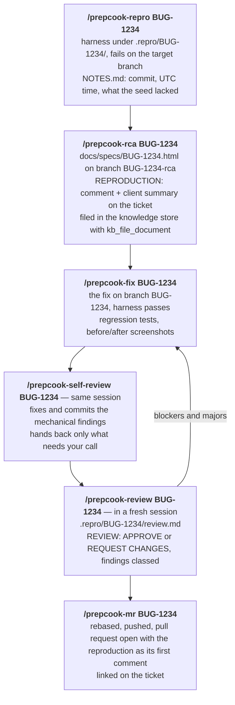
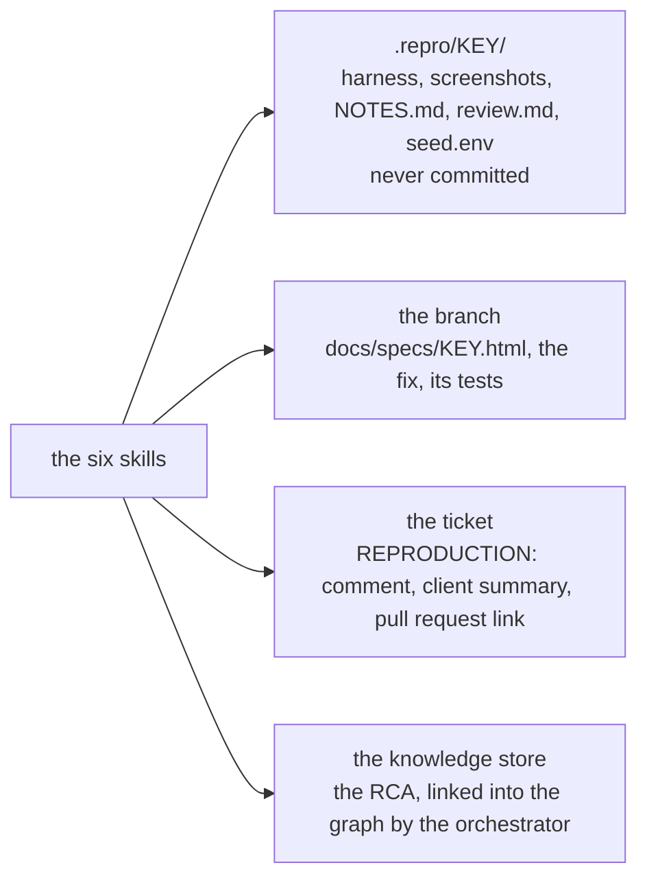

# Prep Cook toolkit

A prep cook does the prep so the chef can cook. Prep Cook does the prep on a
bug — reproduces it, explains it, fixes it, reviews the fix, opens the pull
request — and the engineer who owns the ticket signs off.

These are Claude Code skills that do on your machine what the Prep Cook
orchestrator does on a card: reproduce a bug, write the root-cause analysis,
fix it, review the fix cold, open the pull request. The skills are generated from the orchestrator's own
stage playbooks (`crates/services/src/services/config/playbooks.rs`), so a ticket
worked here produces the same harness, the same RCA and the same pull request as
one the orchestrator worked — and its RCA lands in the same knowledge store.

The app comes from the same place too: the repository's `.prepcook/scripts.toml`
([docs/scripts.md](../docs/scripts.md)), whose `setup`, `build`, `start` and
`seed` you run yourself, and whose seed hands you the same `PREPCOOK_APP_URL`,
`PREPCOOK_TEST_USER_EMAIL` and `PREPCOOK_TEST_USER_PASSWORD` an orchestrated agent gets.
Your tracker stays your tracker; the skills read and write the ticket through
its MCP.

## Install

Once per machine, with Claude Code, Node, and `gh` or `glab` installed:

```sh
cargo build --release --bin prepcook-mcp        # in this checkout; or take prepcook-mcp from a GitHub release of Prep Cook
toolkit/setup.sh --backend-url http://localhost:<port> --mcp target/release/prepcook-mcp
```

`--backend-url` is the Prep Cook server whose knowledge store your RCAs are filed in:
your own (the port is `BACKEND_PORT`, or the one it printed on start), or your
team's. `setup.sh --no-mcp` installs the skills without it. The
script is safe to run again after a `git pull`, and `setup.sh --uninstall`
reverses it; [setup.sh](#setupsh) below says what it does.

Then connect your tracker's MCP to Claude Code once (for Jira, Atlassian's MCP
server, following Atlassian's instructions).

## Standing the app up

A session starts in your repository's checkout with the app already running from
its manifest and its login in the environment. Prep Cook has no command for that yet,
so you run the manifest's steps yourself, with the variables Prep Cook would set
([docs/scripts.md](../docs/scripts.md#environment) lists them all). For the Pantry
example in [docs/examples/scripts.toml](../docs/examples/scripts.toml):

```sh
cd ~/code/pantry && git checkout main && git pull       # the target branch, for a reproduction
grep -qxF '.repro/' .git/info/exclude || echo '.repro/' >> .git/info/exclude
mkdir -p .repro

export PREPCOOK_PORT=4200 PORT=4200 PREPCOOK_APP_URL=http://127.0.0.1:4200 PREPCOOK_WORKTREE="$PWD"
export PREPCOOK_RUN_ID="$(uuidgen 2>/dev/null || date +%s)"
export PREPCOOK_ENV_OUT="$PWD/.repro/seed.env"; : > "$PREPCOOK_ENV_OUT"
# The [secrets] the manifest requires, from the store `prepcook secret set` writes.
[ -f ~/.config/prepcook/secrets.env ] && { set -a; . ~/.config/prepcook/secrets.env; set +a; }

npm ci && npm run build                                              # [app] setup, build
DATABASE_PATH=.prepcook/pantry.sqlite node dist/server.js &              # [app] start (stays up)
until curl -sf "$PREPCOOK_APP_URL/healthz" >/dev/null; do sleep 1; done # [app] ready
DATABASE_PATH=.prepcook/pantry.sqlite node scripts/seed-test-data.mjs    # [app] seed

set -a; . "$PREPCOOK_ENV_OUT"; set +a      # PREPCOOK_TEST_USER_EMAIL and PREPCOOK_TEST_USER_PASSWORD
claude                                  # from this shell, so the session inherits them
```

The login lives in `.repro/seed.env` and your shell, nowhere else: `.repro/` is
excluded from git, and the skills check the variables are set without ever
printing them. To test a change, the skills rebuild and restart the app with the
manifest's `build` and `start`, the way `app_restart` does on a card.

## The loop

Six skills, run in order from your checkout, each picking up where the last
stopped — the orchestrator's planning, executing and review stages, with you
moving the ticket between them.



You can stop after any step and pick up later; each skill checks for what the
previous one left and says what is missing. Everything a skill produces lands in
one of four places:



### `/prepcook-repro <KEY>`

Checks the app is up from the manifest on the target branch, the login is in the
environment and the ticket opens through your tracker's MCP. Reads the ticket,
its comments, attachments and recordings. Builds a Playwright harness under
`.repro/<KEY>/` that asserts the reported behaviour and fails on the target
branch — one JSON line per case, a screenshot per case, exit non-zero on
failure. Intermittent reports are measured as a rate across trials, not a
verdict. When it cannot reproduce, it says which of the four reasons applies
rather than guessing. Stops before diagnosing.

Generated from the reproduction half of the `bug:planning` playbook.

### `/prepcook-rca <KEY>`

Starts from a failing harness. Finds the mechanism — the code path the harness
exercises, confirmed by making the harness pass against a candidate change — and
writes the RCA as one self-contained HTML document at `docs/specs/<KEY>.html` on
a branch `<KEY>-rca`: Symptom, Reproduction (the harness source inline), Root
cause, Blast radius, Proposed fix, Regression tests, Open questions, and
Reproduce locally (the seed notes and a kickoff prompt someone else can paste).
Posts the `REPRODUCTION:` comment and the plain-language client summary to the
ticket, then files the document in the knowledge store with the `prepcook` MCP's
`kb_file_document`; the orchestrator's graph analyst links it on its next run,
exactly as it does its own RCAs. Reads two or three neighbouring RCAs first.

Generated from the RCA half of `bug:planning`.

### `/prepcook-fix <KEY>`

Reads the RCA in full before touching code. Fixes the mechanism it isolated with
the smallest change that achieves the specified behaviour, covering sibling paths
the mechanism runs through. Rebuilds the app and runs the harness until it
passes, then the manifest's `test` — the check the orchestrator runs before a
pull request opens. Adds the regression tests the RCA calls for and captures
before/after screenshots when the change is visible.

Generated from the fix half of `bug:executing`.

### `/prepcook-self-review <KEY>`

Your own review of your own branch, in the same session that wrote the fix.
Judges reuse and pattern fit first, then readability and correctness, and — unlike
`/prepcook-review` — may fix: mechanical, behaviour-preserving findings are repaired
and committed as one commit, the covering tests and the harness re-run, and only
what needs a decision comes back to you.

Hand-maintained, not generated.

### `/prepcook-review <KEY>`

Run it in a **new** Claude Code session, so it has no memory of writing the fix.
Reads the diff against the target and only the `REPRODUCTION:` comment from the
ticket, never the RCA. Every finding is classed and weighted; the verdict is
REQUEST CHANGES only on a systematic or correctness blocker or major. Writes the
review to `.repro/<KEY>/review.md`. Changes nothing.

Generated from the `reviewing` playbook.

### `/prepcook-mr <KEY>`

Rebases onto the target, re-runs the covering tests, pushes, and opens the pull
request with `gh` or `glab`: Summary, Changes, Verification, a line closing the
ticket, and the reproduction as its first comment so a reviewer can run it
themselves. Links the pull request on the ticket.

Generated from the push half of `bug:executing`.

### Supporting skills

`repro-harness` (with `harness.template.mjs`) and `evergreen-comments` are copied
from `assets/agent-skills/`, the skills Prep Cook gives its own sessions, through a few
rules of their own: the app is the one you stood up, the reporting goes to the
ticket, and the template can show the browser (`HEADED=1`). The stage skills call
them; you rarely invoke them directly.

### The product profile

The committed skills are a worked example: their `{{product.*}}` passages are
filled from the `[profile]` of the Pantry manifest, so `/prepcook-repro` says "The
product is Pantry" and `/prepcook-review` grounds product findings in Sign-in, Lists,
Items and Sharing. Regenerate them with your own manifest ([below](#regenerating))
and they name your product instead.

## What each skill needs

| | Needs | Provided by |
| --- | --- | --- |
| All | Claude Code, started from your repository's checkout | you |
| All | Your tracker's MCP (for Jira, Atlassian's) | you, once |
| `/prepcook-repro`, `/prepcook-rca`, `/prepcook-fix`, `/prepcook-self-review` | The app up from `.prepcook/scripts.toml`; `PREPCOOK_APP_URL`, `PREPCOOK_TEST_USER_EMAIL`, `PREPCOOK_TEST_USER_PASSWORD` exported | you, per session ([Standing the app up](#standing-the-app-up)) |
| `/prepcook-rca` | The `prepcook` MCP and a Prep Cook server it can reach | `setup.sh` |
| `/prepcook-mr` | `gh` or `glab`, logged in to your host | you, once |

## setup.sh

Idempotent; prints each step as it does it.

1. Checks `claude` and `node` are on the PATH, and `gh` or `glab`; says which is
   missing and stops.
2. Resolves the `prepcook-mcp` binary (`--mcp PATH`, else the one on PATH) and the
   server URL (`--backend-url`, else `PREPCOOK_BACKEND_URL`), and stops before
   changing anything if either is missing. Nothing is downloaded.
3. Symlinks every `toolkit/skills/<name>` into `~/.claude/skills/<name>`,
   refreshing a symlink of ours and refusing to touch a real directory or
   someone else's symlink with the same name.
4. Registers the MCP for every project:
   `claude mcp add -s user prepcook -e PREPCOOK_BACKEND_URL=<url> -- <prepcook-mcp> --mode global`,
   replacing a previous `prepcook` entry.
5. Prints what is left: the tracker's MCP if none looks connected, logging in
   `gh` or `glab`, standing the app up.

`--uninstall` removes the symlinks and the `prepcook` MCP entry. A `git pull` that
changes the skills needs no re-run; the symlinks follow.

`setup.sh` is the only part of Prep Cook that changes your Claude Code config
or puts skills in `~/.claude/skills`, and only when you run it. The Prep Cook
app never writes to either: the agent sessions the app launches get the
`prepcook` server through `claude --mcp-config`, and the skills in
`assets/agent-skills/` through `claude --add-dir`, both pointing into the app
data directory and both for that session alone, so your own sessions in other
repositories load only what you installed.

## Regenerating

`toolkit/skills/` is generated and committed; `toolkit/generator/` is how. Python
3.11 or later, nothing to install:

```sh
python3 toolkit/generator/generate.py            # writes toolkit/skills/ from this checkout
python3 toolkit/generator/generate.py --check    # exits 1 when toolkit/skills/ is stale
python3 -m unittest discover -s toolkit/generator -v
```

Each generated skill is a hand-written preamble (`generator/preambles/`), then
the playbook text run through `generator/substitutions.py` and cut at the
skill's anchor, then a hand-written tail for the skills that have one. The
substitution table is the record of every difference between an orchestrated
agent and a person at a laptop — template, environment, board, gate and runner
— with the reason for each rule. The note at the top of each skill names the
commit its inputs were last changed in; `--check` ignores that line and compares
the rest. CI runs `--check` and the tests, so a playbook edit that breaks a rule,
lets a board-only word through, or is not regenerated fails the build.

### With your own manifest

A team regenerates the skills for its own product in its clone of Prep Cook:

```sh
python3 toolkit/generator/generate.py --manifest ~/code/your-app/.prepcook/scripts.toml
python3 toolkit/generator/generate.py --manifest ~/code/your-app/.prepcook/scripts.toml --check
```

The `[profile]` of that manifest fills the product name, summary, areas, seed
error patterns and evidence tools; nothing else changes. The skills `setup.sh`
linked pick the regeneration up at once.

## Improving a skill

The skills are files in your clone, so edit them and try the edit on a real
ticket. If it is better than the original, open a pull request with the diff.
Good edits become playbook changes — usually with a matching rule in the table —
and the next regeneration carries them, so your improvement reaches every
orchestrated agent too. Until then, `--check` reports the edited skill as stale:
that is the signal that the edit is a proposal, not yet the playbook.
`prepcook-self-review` is the exception: it is maintained by hand here, and an edit
to it is the change itself.
